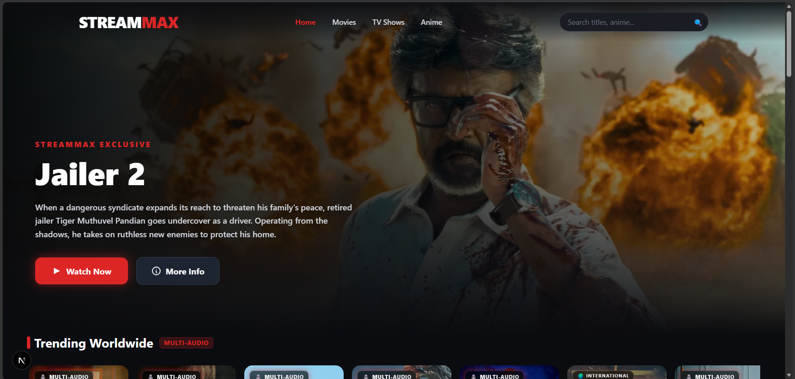
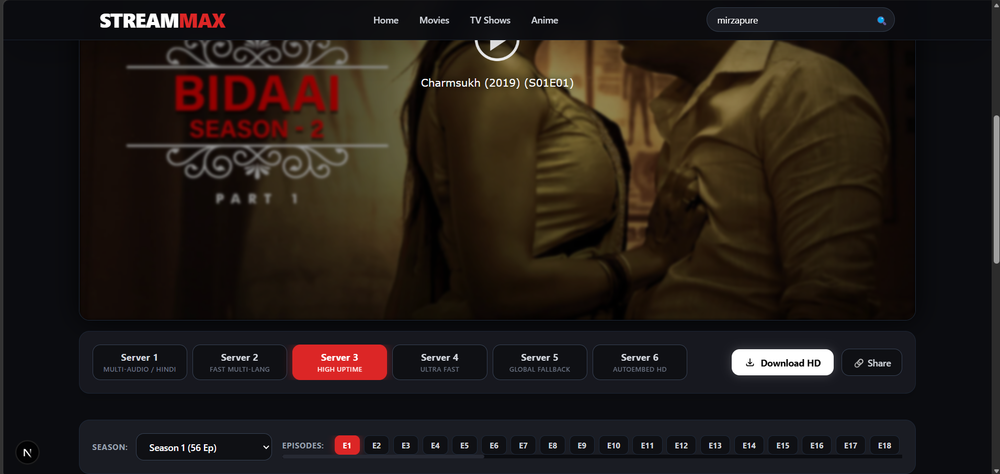
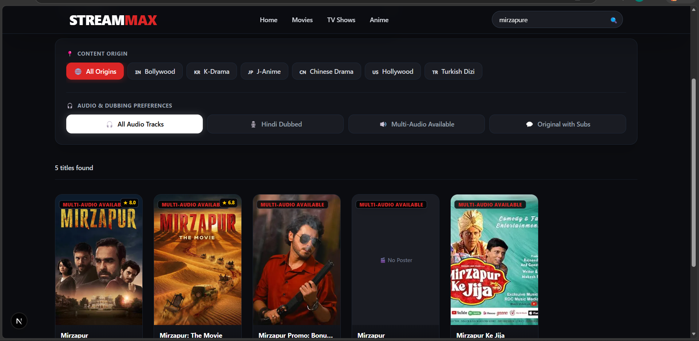

# 🎬 StreamMax — Enterprise Movie, TV & Anime Streaming Platform

<div align="center">

  
  
  
  
  

  <br />

  **[🌐 Live Site (streammax.com)](https://streammax.com)** • **[👨‍💻 Developer Portfolio](https://vinodkumarjaipal.github.io/)** • **[🐙 GitHub Profile](https://github.com/vinodkumarjaipal)**

</div>

---

## 📸 Platform Preview & Screenshots

> **Note:** To display your real website screenshots here, create a folder named `screenshots/` in your project root, add your image files (`hero-preview.png`, `player-preview.png`, `search-preview.png`), and commit them.

<div align="center">

### 🍿 Hero Banner & Trending Feed

*Cinematic hero banner with dynamic backdrop overlays, high-res poster cards, and interactive categories.*

---

### 🎥 6-Server Streaming Player & Cloud Download Modal

*Multi-server streaming engine with multi-audio, subtitle selection, dynamic episode switching, and direct cloud mirrors.*

---

### 🔍 Advanced Multi-Filter Search & Origin Discovery

*Real-time debounced multi-language search with Origin (Bollywood, K-Drama, Anime) and Audio (Hindi Dubbed, Multi-Audio) filters.*

</div>

---

## ⚡ Key Features & Capabilities

- **🚀 Cutting-Edge Tech Stack:** Built with Next.js 16 (App Router), React 19 Server Components, and Tailwind CSS 4.
- **🔑 Dual-Key API Rotation:** Dynamic key rotation (`TMDB_KEY_1` ↔ `TMDB_KEY_2`) with 8-second timeout handlers to guarantee 99.9% metadata uptime.
- **📡 Multi-Source Metadata Aggregation:** Pulls data seamlessly across **TMDB v3**, **OMDb API** (IMDb ratings & box office), **TVmaze API**, and **Jikan API (MyAnimeList v4)**.
- **📺 6-Server Commercial Streaming Engine:** Isolated iframe embeds with multi-audio tracks (Hindi Dubbed, English, Spanish) and auto-fallback CDN mirrors.
- **💾 Multi-Mirror Cloud Download Engine:** 1-click downloads in 1080p Full HD, 720p HD, direct browser streaming links, and external player compatibility (VLC / MX Player).
- **🍿 Episodic Navigation System:** Interactive season dropdowns and zero-latency episode grid switches for TV series and anime.
- **🛡️ Enterprise Security Defenses:** Zero client-side API key leaks, 100-char input sanitization, in-memory IP rate-limiting (60 req/min), and sandboxed iframe isolation.

---

## 🏗️ Architecture & Data Flow

```text
[ User Client / Mobile Browser ]
               │
               ▼
   [ Next.js 16 Edge / App Router ]
      ├── UI Layer (React 19 Server & Client Components)
      ├── Backend Endpoints (/api/search, /api/discover)
      └── Centralized Data Engine (lib/tmdb.jsx, lib/api.jsx)
              │
              ├──────────► TMDB API v3 (Dual Key Rotation)
              ├──────────► OMDb API (Official IMDb Ratings)
              ├──────────► TVmaze API (Free TV Data Redundancy)
              └──────────► Jikan API (MyAnimeList v4)
              │
              ▼
[ 6 Commercial Streaming Servers + 3 Download Cloud Mirrors ]
```

---

## 🔌 API Integrations & Redundancy

| Provider | Primary Function | Fallback / Redundancy Role |
| :--- | :--- | :--- |
| **TMDB API v3** | Movies & TV details, cast grids, backdrops | Auto-switches between Key 1 & Key 2 on rate limits |
| **OMDb API** | IMDb ratings, MPAA ratings, Box Office earnings | Enriches TMDB objects with official IMDb badges |
| **TVmaze API** | International series catalog & episode schedules | Automatic fallback if TMDB returns zero search hits |
| **Jikan API** | Dedicated Anime feeds and top-ranked series | Supplies authentic MyAnimeList scores and posters |

---

## 🎬 Streaming & Download Engine

### 🎥 6-Server Streaming Player

| Server | CDN Provider | Specialty & Audio Support |
| :--- | :--- | :--- |
| **Server 1** | **SmashyStream** | **Multi-Audio (Hindi, English, Spanish) + Multi-Subtitles** |
| **Server 2** | **MultiEmbed** | Ultra-low latency buffer with fast startup time |
| **Server 3** | **2Embed** | Enterprise cluster with 99.9% uptime backup |
| **Server 4** | **VidSrc.pro** | Ultra HD 1080p high bitrate stream mirror |
| **Server 5** | **VidSrc.me** | Global fallback supporting both TMDB ID and IMDb (`tt...`) IDs |
| **Server 6** | **AutoEmbed** | Multi-quality cloud fallback player |

### 📥 Multi-Mirror Download Engine
1. **Fast Cloud Mirror (SmashyStream Portal):** Direct download links with quality picker (1080p, 720p, 480p).
2. **VidSrc VIP Downloader:** High-bandwidth direct CDN link (`dl.vidsrc.vip`).
3. **MultiEmbed Direct Stream Mirror:** In-browser streaming mirror allowing direct right-click save.
4. **Stream Link Share:** 1-click link export for playing in external video players like VLC.

---

## 📂 File & Directory Structure

```text
streammax/
├── .env.local                    # Environment keys (Kept server-side only)
├── next.config.mjs               # External image domains (TMDB, OMDb, TVmaze)
├── tailwind.config.js            # Tailwind v4 theme configuration
├── screenshots/                  # GitHub README screenshot images
├── app/
│   ├── globals.css               # Theme variables & custom scrollbars
│   ├── layout.jsx                # Global navigation shell
│   ├── page.jsx                  # Main Homepage (Hero + 8 Content Rows)
│   ├── anime/                    # Dedicated Anime Collection
│   ├── movies/                   # Paginated Movies Directory
│   ├── tv/                       # Paginated TV Series Directory
│   ├── search/                   # Multi-filter search page
│   ├── movie/[id]/               # Movie detail & player hub
│   ├── tv/[id]/                  # TV detail & episode navigator
│   ├── watch/[type]/[id]/        # Dedicated full-page streaming view
│   └── api/
│       ├── search/               # Server-side sanitized search API
│       └── discover/             # Origin filtering API (Bollywood, K-Drama)
├── components/
│   ├── Navbar.jsx                # Responsive header & mobile menu drawer
│   ├── HeroBanner.jsx            # Dynamic cinematic banner
│   ├── MovieCard.jsx             # Poster card with hover badge effects
│   ├── ContentRow.jsx            # Smooth horizontal scroll row
│   ├── RealStreamPlayer.jsx      # Multi-server player & download modal
│   └── TvPlayerSection.jsx       # Interactive Season & Episode manager
└── lib/
    ├── tmdb.jsx                  # TMDB client with dual-key auto-rotation
    └── api.jsx                   # Multi-source API integration engine
```

---

## 🛡️ Security Defenses & Anti-Exploit System

1. **Zero Client Secret Exposure:** API credentials (`TMDB_KEY_1`, `TMDB_KEY_2`, `OMDB_API_KEY`) stay strictly inside Server Components and API routes.
2. **Input Sanitization:** Search query strings are sanitized against code injection (`/[<>'"`;]/g`) and capped at 100 characters max.
3. **In-Memory Rate Limiting:** Enforces a strict **60 requests/minute per IP** ceiling to prevent automated scraping and DDoS attacks.
4. **Iframe Sandboxing:** All video player embeds use restricted sandbox flags: `sandbox="allow-scripts allow-same-origin allow-forms allow-presentation"`.

---

## 🛠️ Local Setup & Installation

### Prerequisites
- Node.js `v18.x` or higher
- npm / pnpm / yarn

### Steps

1. **Clone the Repository:**
   ```bash
   git clone https://github.com/vinodkumarjaipal/streammax.git
   cd streammax
   ```

2. **Install Dependencies:**
   ```bash
   npm install
   ```

3. **Configure Environment Variables:**
   Create a `.env.local` file in the root folder and add your keys:
   ```env
   TMDB_KEY_1=your_tmdb_api_key_1
   TMDB_KEY_2=your_tmdb_api_key_2
   OMDB_API_KEY=your_omdb_api_key
   ```

4. **Run Development Server:**
   ```bash
   npm run dev
   ```
   Open `http://localhost:3000` in your browser.

---

## 👤 Developer Information

**Vinod Kumar Jaipal**
- **Portfolio:** [vinodkumarjaipal.github.io](https://vinodkumarjaipal.github.io/)
- **GitHub:** [@vinodkumarjaipal](https://github.com/vinodkumarjaipal)
- **Live Site:** [streammax.com](https://streammax.com)

---

## 📜 License

This project is licensed under the **MIT License** — feel free to use and modify it for learning and personal deployment.
